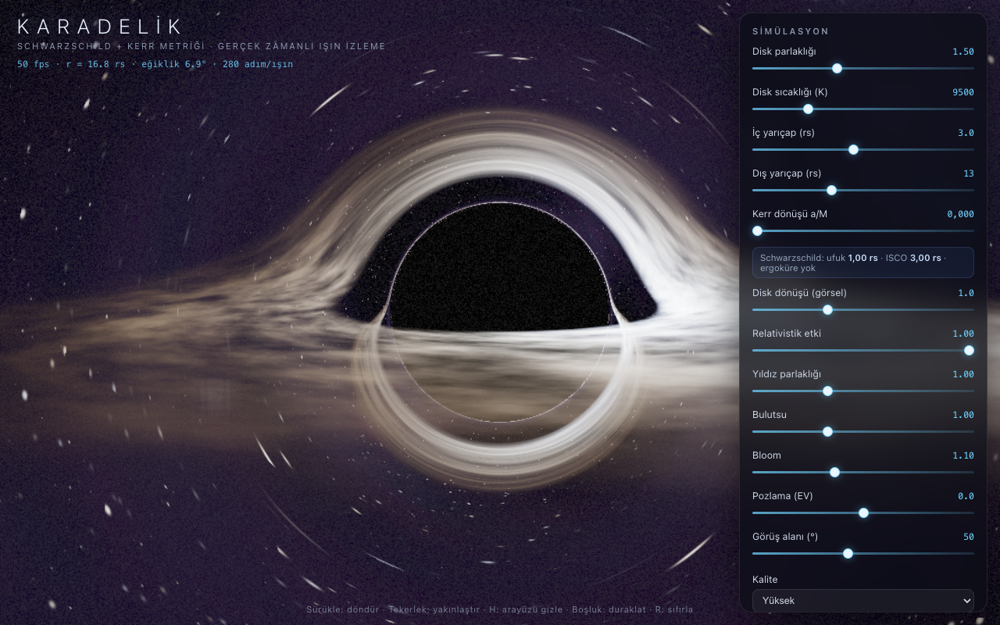
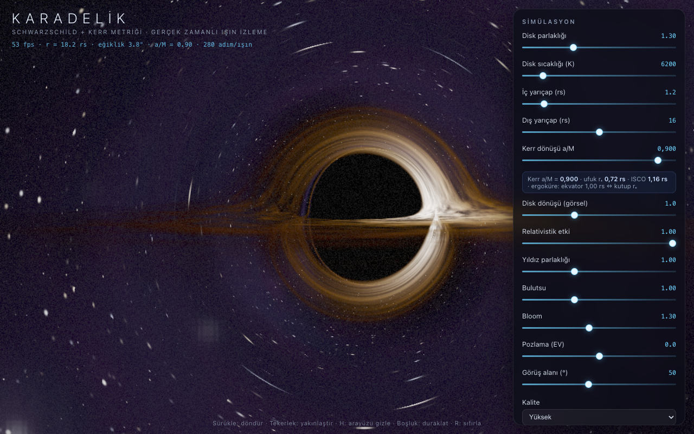
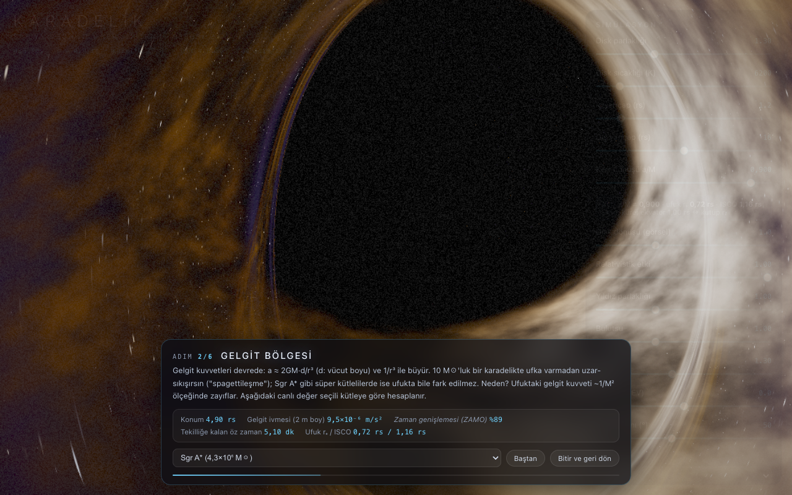
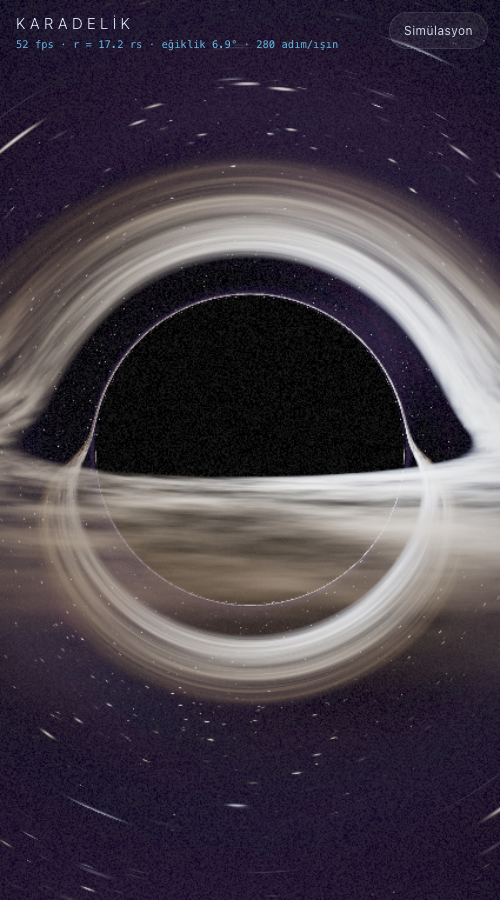

https://blackhole-karadelik.vercel.app/
# Karadelik Simülasyonu 🕳️

Tarayıcıda çalışan, **gerçek zamanlı Schwarzschild ve Kerr (dönen) karadeliği** simülasyonu.
Gravite kaynaklı ışık sapması (gravitational lensing), çerçeve sürüklenmesi (frame dragging),
kütleçekimsel kızıla kayma, Doppler ışınımı ve foton halkası GPU üzerinde ışın izleme
(ray tracing) ile hesaplanır.

Tek dosyadan oluşur: `index.html` — hiçbir bağımlılığı, derleme adımı veya internet
bağlantısı yoktur. Masaüstü ve mobil (dokunmatik) tarayıcılarda çalışır.



## Çalıştırma

**Seçenek 1 — En kolay:** `index.html` dosyasına çift tıklayın (her şey dosyanın
içinde olduğu için doğrudan açılır).

**Seçenek 2 — Yerel sunucu ile:**

```bash
cd black_hole
python3 -m http.server 5757
# tarayıcıda: http://localhost:5757
```

> Not: OpenCode önizleme panelinde WebGL kapalı olduğu için orada çalışmaz;
> normal bir tarayıcı (Chrome / Safari / Edge / Firefox) gerekir. WebGL2 desteği şarttır.

## Kerr: dönen karadelik 🌀

Paneldeki **"Kerr dönüşü a/M"** kaydırıcısı ile karadeliğe dönme (spin) kazandırılır:
`a* = cJ/GM²` boyutsuz dönme parametresi 0 (Schwarzschild) ile 0,998 (ekstremal Kerr)
arasında değişir. Kaydırıcının altındaki bilgi satırı ufuk yarıçapını, ISCO'yu ve
ergoküreyi canlı gösterir. Dönüşle birlikte fizik baştan sona değişir:

- **Çerçeve sürüklenmesi (Lense–Thirring):** Uzay-zaman karadelikle birlikte sürüklenir.
  Ufka yakın hiçbir şey durup bekleyemez; ışık bile dönüş yönüne doğru bükülür. Diskin
  dönüş yönü ile aynı yöne dolanan ışınlar (prograde) ufka çok daha yaklaşabilir.
- **Ergoküre:** `r_ergo(θ) = M + √(M² − a²cos²θ)`. Dönüş yüzünden ufkun dışında, ekvatorda
  `2M = 1,00 rs`ye kadar uzanan bir bölge oluşur; kutuplarda ise ufka değer. Bu bölgenin
  içinde **durağan kalmak imkânsızdır** — düşmesen bile karadelikle birlikte dönmek
  zorundasın. "Ergoküre parlaması" seçeneği bu kabuğu görselleştirir (penrose süreci
  buradan enerji çekmeyi mümkün kılar).
- **ISCO kayması:** En iç kararlı dairesel yörünge Schwarzschild'de 3 rs'tir; Kerr'de
  prograde yönde içeri gelir: `a* = 0,9` için **1,16 rs**, ekstremal sınırda `0,5 rs`ye
  kadar iner. Retrograde yörüngelerde ise `4,5 rs`ye kadar uzaklaşır.
  **"İç yarıçapı ISCO'ya otomatik uydur"** seçeneği diskin iç kenarını bu değere bağlar.
- **Gölge şekli:** Dönüş, gölgeyi "D" biçiminde basıklaştırır — kritik eğri dönüş yönüne
  doğru yassılaşır, dik kenar prograde tarafta oluşur.
- **Halka tekilliği ve iç ufuk:** Kerr'in derinliklerinde tekillik nokta değil, ekvator
  düzleminde bir **halkadır** ve ufkun içinde ikinci bir **iç (Cauchy) ufuk** bulunur.
  Klasik çözümde halkadan geçmek başka bir evrene açılır; ancak Cauchy ufku kararsızdır
  (kütle enflasyonu) — bu yüzden gerçekçi karadelikler bir "geçit" olarak modellenmez.
  Kerr yolculuğu bu yüzden ufkun hemen dışında biter ve iç bölgeyi anlatır.

**Hazır Kerr ayarları:** **Gargantua** (`a* = 0,9` — Interstellar görünümü) ve
**Ekstremal** (`a* = 0,998` — ufka yapışan foton yörüngeleri, ekvatorda dev ergoküre).



## Yolculuk modu: karadeliğin içine düş

Paneldeki **"Yolculuğa Başla"** düğmesi seni 15 rs'ten başlayıp karadeliğin eşiğine
götüren 6 adımlık rehberli bir düşüşe çıkarır. Her adımda o bölgede fiziğin ne
yaptığını anlatan bir metin ve **canlı fizik okumaları** gösterilir:

- Konum (r / rs)
- Vücuduna etkiyen gelgit ivmesi (2 m boy, seçilen kütleye göre)
- Zaman genişlemesi (Schwarzschild'de `√(1 − rs/r)`, Kerr'de yerel ZAMO saat hızı)
- Serbest düşüşte tekilliğe kalan öz zaman (≈ 6,6 µs × M/M☉ × (r/rs)^1,5)

Kütle seçici ile aynı düşüşü 10 M☉ / Sgr A* / M87* için karşılaştırabilirsin —
yıldız kütleli bir karadelikte "spagettileşirsin", süper kütlelide ufku hissetmezsin.

**Kerr ile yolculuk:** `a/M > 0` iken her adımın Kerr'e özgü metni devreye girer ve
düşüş ufkun **hemen dışında** (`r₊ + 0,07 rs`) sona erer — çünkü Boyer–Lindquist
koordinatları ufkun içinde geçersizdir; iç bölge (halka tekilliği, Cauchy ufku,
kütle enflasyonu) metinle işlenir. Ufka yaklaşırken ergoküre parlaması otomatik
olarak belirginleşir.



## Fizik: düşerken ne olur?

| Aşama | Düşen gözlemci | Uzaktaki gözlemci |
|---|---|---|
| Yaklaşma | Neredeyse Newton fiziği | Normal görünürsün |
| Gelgit bölgesi | a ≈ 2GM·d/r³; 10 M☉'ta ölümcül, Sgr A*'ta değil | — |
| Ufka yakın | Saatin normal işler | Seni kızıla kaymış, yavaşlamış görür; ufukta donar ve sönersin |
| Ufku geçiş | **Yerel olarak hiçbir şey özel değil** (Eşdeğerlik İlkesi) | Seni asla geçerken göremez |
| İçeride | r zaman gibi davranır; dönüş yok. Dış evren arkanda maviye kaymış e sadece "geriye bakınca" görünür; tekillik yönü kara | — |
| Tekillik | Kaçınılmaz: bir yer değil, geleceğindeki bir an | — |

**"Karadelikten geçmek" mümkün mü?** Klasik (dönmeyen) Schwarzschild karadeliğinde
hayır: içeriye düşen her dünya çizgisi tekillikte biter. Dönen (Kerr) karadeliklerde
halka biçimli tekillik kuramsal olarak başka bir evrene açılır; ancak iç (Cauchy) ufuk
kararsızdır (kütle enflasyonu) — bu yüzden gerçekçi karadelikler bir "geçit" değil,
bir son olarak modellenir.

## Kontroller

| Girdi | İşlev |
|---|---|
| Sürükle (fare / parmak) | Kamerayı döndür |
| Tekerlek / iki parmak | Yakınlaştır — uzaklaştır |
| `H` | Arayüzü tamamen gizle / göster |
| `P` | Kontrol panelini gizle / göster |
| `Boşluk` | Simülasyon zamanını duraklat / devam |
| `R` | Kamerayı sıfırla |

### Mobil / dokunmatik



- Telefonlarda sayfa **panel kapalı** açılır: karadelik tam ekran görünür. Sağ üstteki
  **Simülasyon** düğmesi paneli alttan açılır bir sayfa (bottom sheet) olarak getirir;
  panelin sağ üstündeki **✕** ile kapanır.
- Tek parmakla sürükle → döndür, iki parmakla → yakınlaştır. Çift dokunma zoom'u ve
  sayfa kaydırma, tam ekran deneyimi bozmasın diye kapatılmıştır.
- İlk açılışta kalite dokunmatik cihazlarda **Orta**'dır; cihaz zorlanırsa kalite
  otomatik olarak bir kademe düşürülür. Kaliteyi panelden elle seçersen otomatik
  düşürme devre dışı kalır.
- Çentik / güvenli alan (safe-area) boşlukları ve iOS adres çubuğu yükseklik
  değişimleri (`dvh`) hesaba katılır.

## Simülasyon paneli

- **Disk parlaklığı / sıcaklığı** — yığılma diskinin (accretion disk) parlaklığı ve
  siyah cisim sıcaklığı (renk bu sıcaklıktan hesaplanır).
- **İç / dış yarıçap (rs)** — diskin boyutları. Schwarzschild'de iç yarıçapın fiziksel
  değeri ISCO'dur (3 rs); Kerr'de ISCO içeri kayar (otomatik uydurma seçeneği).
- **Kerr dönüşü a/M** — 0 = Schwarzschild … 0,998 = ekstremal Kerr (yukarıya bakın).
- **Disk dönüşü** — Kepler diferansiyel dönüşünün görsel hızı (Kerr'de çerçeve
  sürüklenmesiyle uyumlu Ω hesabıyla).
- **Relativistik etki** — Doppler ışınımı + kütleçekimsel kızıla kaymayı kapatıp açar.
  1.0'da yaklaşan taraf belirgin şekilde parlak-mavi, uzaklaşan taraf sönük-kırmızıdır.
- **Yıldız parlaklığı / Bulutsu** — arka plan gökyüzü.
- **Bloom / Pozlama** — sinematik ışıma ve pozlama (EV).
- **Görüş alanı (FOV)** — kamera merceği.
- **İç yarıçapı ISCO'ya otomatik uydur / Ergoküre parlaması** — Kerr yardımcıları.
- **Kalite** — Düşük / Orta / Yüksek / Ultra (çözünürlük ölçeği + ışın başına adım sayısı).

**Hazır ayarlar:** Sinematik · Bilimsel · Alev · Hayalet · Gargantua · Ekstremal

## Fizik

- **Metrik:** Schwarzschild ve Kerr (Boyer–Lindquist). Birim uzunluk `rs = 2GM/c²`
  (kod içinde `RS = 1`, `M = 0.5`; Kerr'de `a = M·a*`).
- **Olay ufku:** Schwarzschild'de `r = rs`; Kerr'de `r₊ = M + √(M² − a²)`
  (`a* = 0,9` için 0,72 rs). Işın buraya düşerse yutulur (ekranda siyah gölge).
- **Foton küresi:** Schwarzschild'de `r = 1.5 rs` — kritik çarpma parametresi
  `b_c = 3√3 M ≈ 2.6 rs`. Kerr'de ufka doğru daralan iki foton yörüngesi vardır
  (`a* = 0,9` için 0,78 rs / 1,96 rs) ve dönen ışınlar bu civarda birkaç tur atarak
  **foton halkasını** oluşturur.
- **ISCO (Bardeen–Press–Teukolsky):** prograde/retrograde yörüngeler için farklı;
  kod `a*`ya göre analitik kökleri hesaplar.
- **Işın izleme (Kerr):** Boş (null) jeodezikler, Hamilton formülasyonunda korunumlu
  büyüklüklerle (`E = −p_t`, `L = p_φ`, Carter `Q`) RK4 ile entegre edilir; adım boyu
  ufka ve kutup dönüşlerine göre uyarlanır. `a ≈ 0` sınırında eski Schwarzschild
  izleyicisine geçilir — `a = 0` görünümü birebir korunur.
- **Disk:** Kepler hızı `Ω = √M / (r^{3/2} + a√M)`; sıcaklık profili `T ∝ r^{−3/4}`
  (Shakura–Sunyaev); renk Planck (siyah cisim) eğrisinden.
  - Doppler faktörü: `D = 1 / (γ(1 − β·n))`, parlaklık artışı `∝ D³`,
    gözlenen sıcaklık `T_göz = D·T` (Kerr'de hız yerel ZAMO çerçevesine göredir).
  - Kütleçekimsel kızıla kayma: `√(1 − rs/r)`.
- **Kamera:** Kerr'de ZAMO (sıfır açısal momentumlu gözlemci) — çerçeve
  sürüklenmesiyle birlikte döner, ufkun dışında kalır (yolculuk `r₊ + 0,07`de biter).
- **Arka plan:** Yıldızlar prosedürel gürültüyle üretilir ve merceklenmiş yön
  üzerinden örneklenir; diskin arkasındaki yıldızlar halka şeklinde bozulur.

### Doğrulama

Koddaki izleyici bir test paketiyle doğrulanmıştır: Hamilton kısıtı ve Carter sabiti
yalnızca `~10⁻⁵` mertebesinde sürüklenir; Schwarzschild sınırında Binet denklemiyle
yörünge açıları `10⁻⁶` rad uyuşur; `a* = 0,9` için foton yörünge yarıçapları analitik
değerlerle (`0,7789 / 1,9552 rs`) 4 basamağa kadar örtüşür.

## Teknik notlar

- WebGL2 + GLSL ES 3.0, HDR (RGBA16F) hedef + çok geçişli bloom + ACES ton eşlemesi.
- Sahne tek fragment shader'da çizilir; ardından parlaklık ayıklama, ayrılabilir
  Gauss bulanıklığı (1/2 ve 1/8 çözünürlük) ve kompozit geçişleri uygulanır.
- URL parametreleri (test/performans için):
  `?q=low|medium|high|ultra`, `?scale=0.5`, `?steps=120`, `?preset=gargantua|ekstremal`,
  `?kerr=0.9`, `?journey=35` (yolculuğu 35. saniyeden başlat),
  `?dist=0.5&pitch=0.45` (kamera konumu), `?panel=0` (panel kapalı başlasın),
  `?ui=0` (tüm arayüz gizli — vitrin/screenshot modu)
